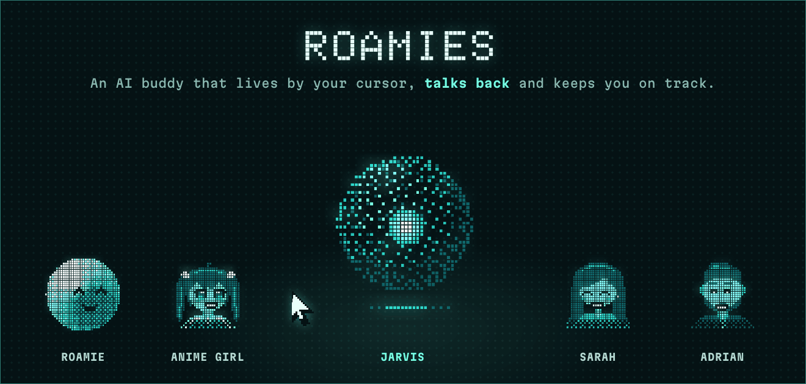

<p align="center">
  
</p>

<p align="center">
  
</p>

<p align="center">
  <strong>A little buddy that lives on your screen and keeps you on track.</strong>
</p>

<p align="center">
  <a href="https://github.com/KenKaiii/Roamies/releases/latest"></a>
  <a href="https://github.com/KenKaiii/Roamies/stargazers"></a>
  <a href="https://github.com/KenKaiii/Roamies/releases"></a>
  <a href="LICENSE"></a>
  <a href="https://youtube.com/@kenkaidoesai"></a>
  <a href="https://skool.com/kenkai"></a>
</p>

Roamies is a little AI buddy that lives on your desktop. It stays by your cursor, talks back in its own
voice, keeps track of what you said you'd do and nudges you when it's due.

> ⭐ **If Roamies keeps you on track, give it a star.** It's the main way other people find it.

## Why Roamies

- **Just talk to it.** Hold ⌃⌥ (Ctrl+Alt on Windows) to talk and let go to send, or tap it for hands-free.
  It answers in speech bubbles and acts out what it's doing. Esc stops a reply, or sends it away.
- **It talks back.** Add a [Fish Audio](https://fish.audio) key and every reply is spoken in your Roamie's
  own voice, with real feeling: a laugh when something's funny, a whisper for a secret. Pick Drama 3 for the
  most expressive voice, or S2.1 Pro for a cheaper one.
- **Pick your Roamie.** Five looks, each with its own name, voice and animations: Roamie, JARVIS, Anime Girl,
  Sarah and Adrian. Three sizes: Default, Small, or Cursor, a pixel pointer that rides along with your mouse.
- **It remembers.** Commitments with reminders down to the second, facts about you, and conversations
  that pick up where you left off. A conversation starts fresh after two quiet hours or on a new day.
  Search what it knows, or make it forget, from the Memory page.
- **It sees and points.** It can screenshot a specific window, read what's in it, and point at the exact
  spot on screen you need to click. ⌃⌥A lets you snap an area of the screen and ask about it.
- **It works your apps.** It can open apps, sites and files, and click or type in other apps for you.
- **Your subscriptions.** Claude, ChatGPT, Gemini, Grok, Kimi or API keys. It signs in through the same
  `~/.gg/auth.json` as GG Coder, so if GG Coder is signed in, so is Roamies.

## Also included

- **The Roamies panel:** click the menu bar icon (the tray icon on Windows) for what it's doing, what it did
  lately, what it remembers, and every setting: model, look and size, voice, behavior and updates.
  Right-click for a short menu.
- **Gets to know you:** the setup guide ends with a short chat where it asks about you and shows what
  it'll remember.
- **Safe by default:** writing files, running commands and controlling other apps are off until you turn
  them on in setup or the panel ("Allow file edits and commands"). Even then, anything that changes things
  asks you first, and the dangerous stuff never runs: admin commands, wiping disks or your home folder,
  reading passwords and keys, startup scripts, downloaded scripts, and typing into terminals or password apps.
- **Shows its work:** every tool call plays its own animation, so you can see when it's taking a
  screenshot, reading a file, running a command or searching the web.
- **Keeps your keys safe:** your Fish Audio key lives in the macOS Keychain, or encrypted for your
  Windows user, never in a plain file.
- **Stays out of the way:** it lives in the menu bar, not your Dock. ⌃⌥S shows or hides your Roamie, and
  every shortcut can be changed. "Open at login" is on by default.
- **Updates itself:** when a new version is out, your Roamie tells you, and one click in the panel does the
  rest. Updates are signed and checked before they install.
- **Setup guide:** opens on first launch and walks through permissions (microphone, screen recording,
  accessibility, files), connecting an AI account, shortcuts, getting to know you and where to find the menu
  bar icon. Reopen it any time from the panel's About page.

Talking to it works best on macOS 26+, which doesn't need Siri or Dictation turned on. On Windows, it runs
NVIDIA's Parakeet speech model on your PC (about 670 MB, downloaded once from the setup guide), so your
voice never leaves it. Spoken replies need a Fish Audio account and are billed to it; the panel shows what
each voice model costs. Window reading, pointing and app control are macOS only for now.

<sub>Voice on Windows uses [NVIDIA Parakeet TDT 0.6B v3](https://huggingface.co/nvidia/parakeet-tdt-0.6b-v3)
([CC BY 4.0](https://creativecommons.org/licenses/by/4.0/)), in the ONNX export by
[istupakov](https://huggingface.co/istupakov/parakeet-tdt-0.6b-v3-onnx), run with
[parakeet-rs](https://github.com/altunenes/parakeet-rs). The model is downloaded at setup, not bundled.</sub>

## Get started

1. Install Roamies:

   **macOS (Apple silicon or Intel):** [Download the latest release](https://github.com/KenKaiii/Roamies/releases/latest) and open the `.dmg` for your Mac (`aarch64` for Apple silicon, `x64` for Intel).

   **Windows:** [Download the latest release](https://github.com/KenKaiii/Roamies/releases/latest) and run the `.exe` installer. It isn't code-signed yet, so Windows shows a SmartScreen warning the first time.

   **Development:** With Rust, Node.js 22+, the [Tauri prerequisites](https://v2.tauri.app/start/prerequisites/) and, on macOS, the Xcode Command Line Tools installed:

   ```bash
   git clone https://github.com/KenKaiii/Roamies.git
   cd Roamies/showcase/tauri
   (cd sidecar && npm ci && npm test)
   ./build.sh dev        # debug build
   ./build.sh            # release bundle for this OS
   ```

2. Open the app, follow the setup guide, pick your Roamie, and hold ⌃⌥ to say hi.

## Build with the framework

Every Roamie's brain is a [gg-framework](https://github.com/KenKaiii/gg-framework) agent running in a Node
sidecar. Want to build your own? Install just what you need.

- [**@kenkaiiii/gg-ai**](https://github.com/KenKaiii/gg-framework/blob/main/packages/gg-ai/README.md): Connect to AI providers and stream responses.
- [**@kenkaiiii/gg-agent**](https://github.com/KenKaiii/gg-framework/blob/main/packages/gg-agent/README.md): Build agents that use your tools and work through tasks.
- [**@kenkaiiii/gg-core**](https://github.com/KenKaiii/gg-framework/blob/main/packages/gg-core/README.md): Model selection, authentication, and local model discovery.

For your own agent, start here:

```bash
npm install @kenkaiiii/gg-ai @kenkaiiii/gg-agent
```

The package links above cover setup and usage. Roamies is licensed under [AGPL-3.0](LICENSE): you can build
on it, and if you distribute your changes or run them as a network service, you share their source under
the same license.

## Contributing

Bug reports, ideas and pull requests are welcome. [Open an issue](https://github.com/KenKaiii/Roamies/issues)
to get started, and report security problems as described in [SECURITY.md](SECURITY.md).

## Learn with me

Come build with me in my [Skool community](https://skool.com/kenkai). Get help, share what you're making, and learn how to get more out of AI.

## Star history

<a href="https://star-history.com/#KenKaiii/Roamies&Date">
  <picture>
    <source media="(prefers-color-scheme: dark)" srcset="https://api.star-history.com/svg?repos=KenKaiii/Roamies&amp;type=Date&amp;theme=dark">
    
  </picture>
</a>

<p align="center">If Roamies is useful to you, ⭐ star the repo so more people find it.</p>
